# PCA - Principal Component Analysis
PCA is a technique which can transform a higher dimensional data into a lower dimensional data. It is a technique of feature extraction. PCA is used to reduce the number of features in the dataset while retaining as much information as possible.

## Benefits of PCA
1. Reduces the number of features in the dataset.
2. Faster training of the model.
3. Lower computational cost.
4. Visualization of high-dimensional data in 2D or 3D space.

## Geometric Intuition of PCA
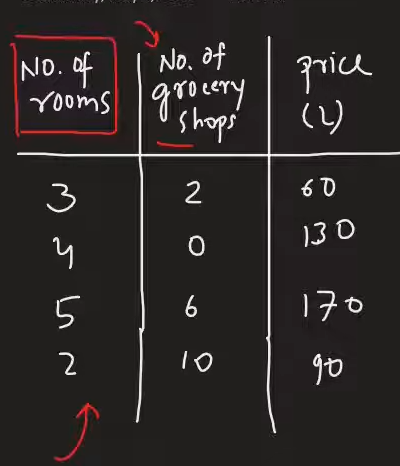
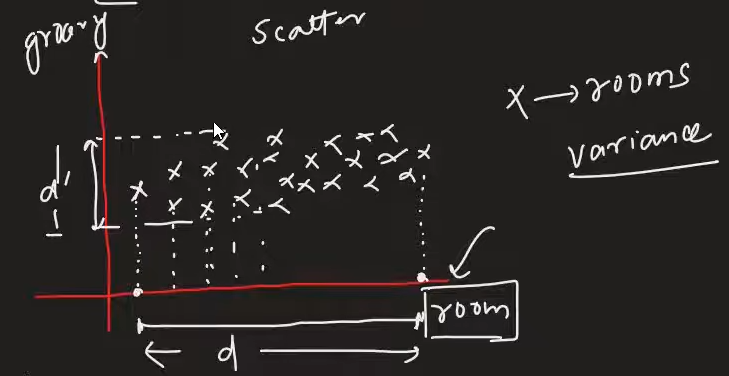
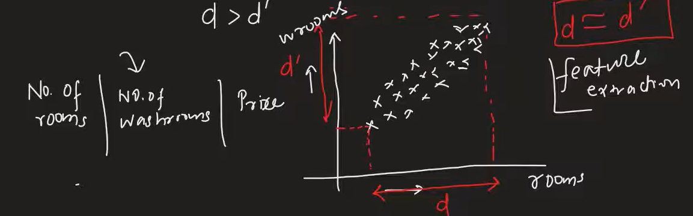

## Why Variance or spread is important in PCA?
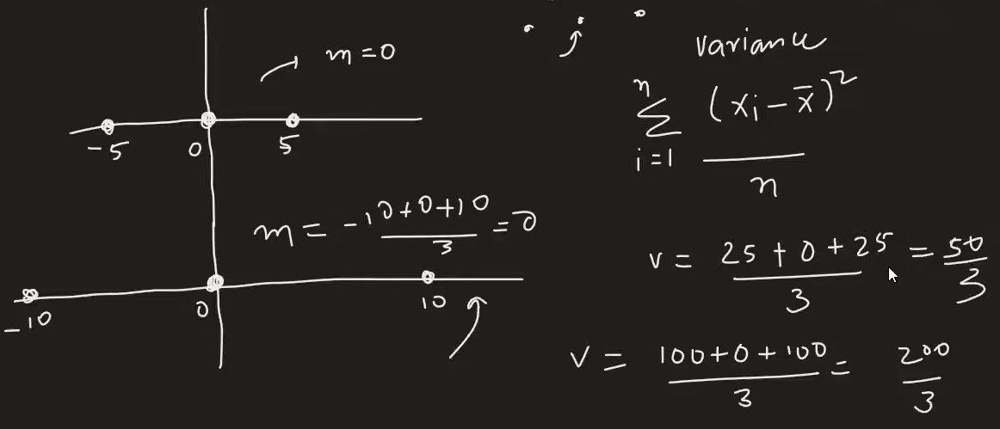
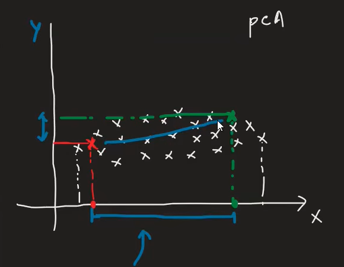

## Covariance and Covariance Matrix
### Covariance Formula
Cov(X, Y) = Σ (Xi - Xmean)(Yi - Ymean) / (n - 1)

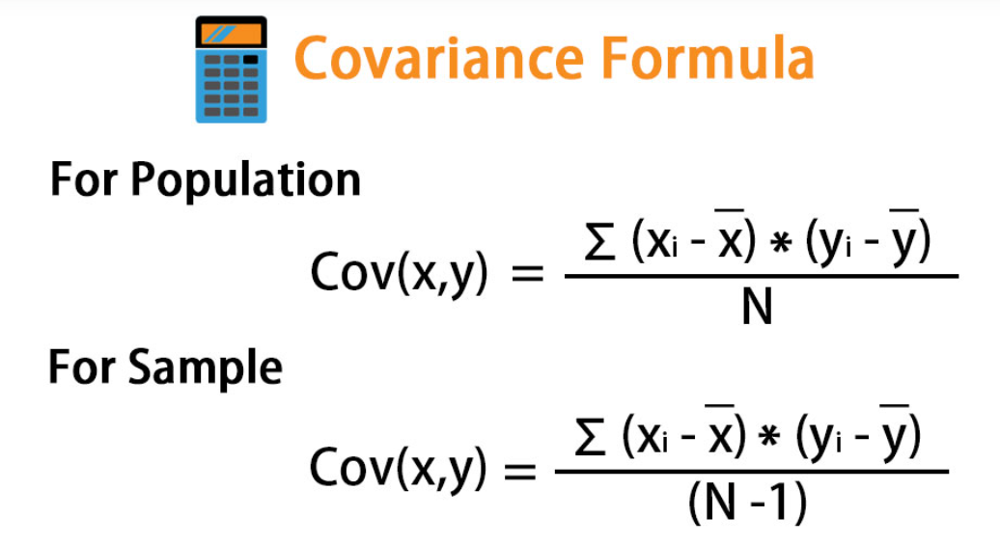

### Covariance Matrix
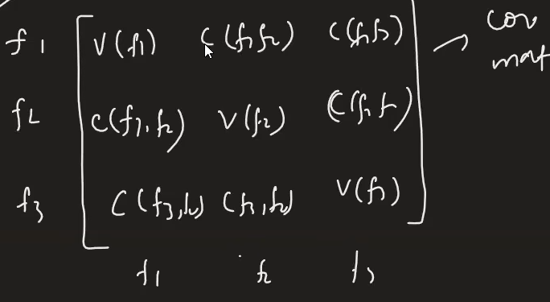

## Eigen Vectors & Eigen Values 
Eigen vectors are the directions in which the data varies the most. Eigen values are the magnitudes of this variation.

Eigenvalues are the values that represent the magnitude of the variance in the direction of the corresponding eigenvectors. In PCA, we compute the eigenvalues and eigenvectors of the covariance matrix to identify the principal components.

### Read the following article to understand Eigen Vectors and Eigen Values in detail:
[A geometric interpretation of the covariance matrix](https://www.visiondummy.com/2014/04/geometric-interpretation-covariance-matrix/)

## Step by Step Solution of PCA
1. Mean Centricg
2. Covariance Matrix
3. Eigen Vectors and Eigen Values
4. After getting all principal components, we transform the original data into the new feature space.

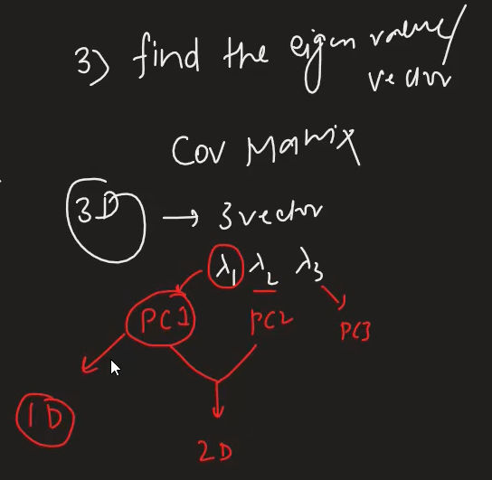

## How to transform points
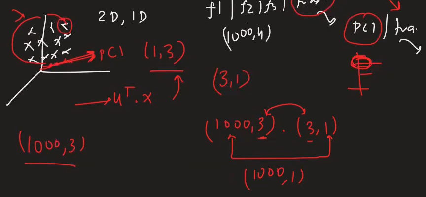

### Dataset Link
[Dataset Link](https://www.kaggle.com/c/digit-recognizer)

## How to find optimum number of components
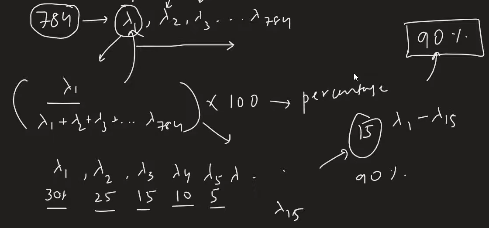

## When PCA does not work
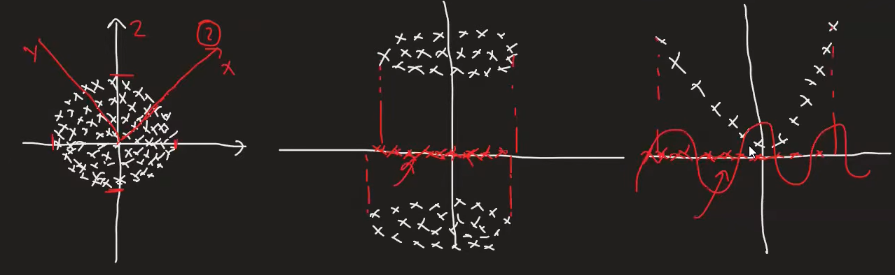